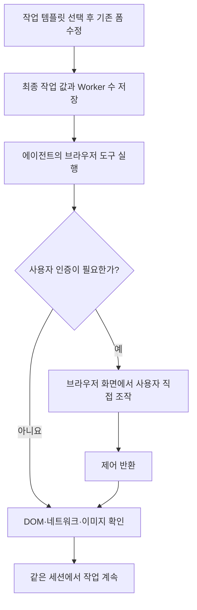

# 브라우저·인증 세션과 실행 프리셋

Docker 이미지에 포함된 Chromium으로 JavaScript 페이지를 탐색하고, 같은 브라우저의 화면을 보면서 로그인·추가 인증을 직접 처리할 수 있습니다. 작업 프리셋은 기존 **작업 템플릿** 목록에서 선택해 이름·설명·목표·설정을 채우는 기능입니다. 병렬 실행량과 기본 도구 조합은 **시스템 설정 상단**의 자원 프리셋으로 선택합니다. 설치는 [README](../README.md#빠른-시작), 원본과의 차이는 [변경 문서](changes.md)를 참고하세요.

작업자는 서로 다른 브라우저 프로필을 사용합니다. 사용자가 제어하는 동안 해당 세션의 에이전트 조작은 대기하며, 제어를 반환하면 인증된 같은 페이지에서 이어갑니다. 인증 대기는 작업의 전체 시간 제한을 멈추지 않습니다.

## 브라우저 사용과 로그인

새 설치에서는 기본 `browser` MCP를 Worker와 침투 테스트 채팅에 연결합니다. 기존 설치에서 비활성화했거나 인자를 수정한 경우 그 설정을 유지합니다. 기본 브라우저를 다시 사용하려면 MCP 설정에서 활성화하거나 자원 프리셋을 명시적으로 적용하세요. 사용자 지정 MCP 명령·인자는 프리셋으로 덮어쓰지 않으며, 사용자 지정 브라우저는 아래 관리 화면과 연결되지 않을 수 있습니다.

운영 일반 검증의 새 기본 템플릿은 기존 HTTP·파일·그래프 근거를 우선 재사용하고, 동적 화면이나 사람의 인증을 직접 확인해야 할 때 브라우저를 사용하도록 안내합니다. 공유 대장도 새 결과가 모였을 때 갱신하도록 안내합니다. 기본 템플릿은 최초 등록에만 쓰이므로 이미 편집·생성한 템플릿과 작업 설명은 자동 변경되지 않습니다.

1. 에이전트가 브라우저 도구로 대상 페이지를 엽니다. 로그인·추가 인증이 필요하면 `browser_request_user`로 사용자의 조작을 기다립니다.
2. 화면의 **브라우저 세션** 버튼에서 대기 중인 세션을 엽니다. 주소·탭·화면을 확인하고 클릭, 드래그, 키 입력, 스크롤로 조작합니다.
3. 자격증명은 해당 브라우저의 입력란에 직접 입력합니다. 완료 후 제어를 반환하면 에이전트가 DOM·스크린샷으로 현재 상태를 확인합니다.

인증 대기 중 세션을 닫거나 삭제하거나 브라우저 프로세스가 종료되면 해당 대기는 오류로 끝납니다. 작업 취소도 인증 완료로 처리하지 않습니다. 다음에 같은 세션을 열어 인증을 다시 시작해도 이전 대기의 결과와 섞이지 않으며, 제어 반환 자체는 사이트의 로그인 성공을 보장하지 않습니다.

이 기능은 CAPTCHA 자동 해결기가 아닙니다. 사용자가 같은 화면에서 처리하도록 연결하며 사이트의 자동화 차단이나 인증 정책까지 해제하지는 않습니다. 화면은 이미지 갱신 방식이며 영상 스트리밍은 아닙니다.

브라우저 프로세스는 실제 도구 사용 시 시작합니다. 작업·의도·대화별 프로필을 분리하고 전역 동시 브라우저 상한에 도달하면 빈자리를 기다립니다. 실행 종료·취소 시 프로세스를 정리하며, 프로필의 쿠키·localStorage·sessionStorage는 같은 세션을 재개할 때 사용합니다. 브라우저의 메모리 상태나 열려 있던 모든 탭을 체크포인트처럼 복원하는 기능은 아닙니다. 서버 재시작이 실행 중 에이전트 작업까지 자동 재개하지도 않습니다.

서로 다른 의도는 같은 작업의 Worker라도 새 브라우저 프로필을 사용합니다. 따라서 앞선 의도의 로그인 쿠키가 후속 의도로 자동 전달되지 않습니다. 후속 Worker에는 공유 파일의 안전한 참조와 필요한 재인증 조건을 인계할 수 있지만, 새 의도가 이전 브라우저의 인증 상태를 그대로 이어받는다고 가정하지 마세요.

프로필은 Compose의 **`artex-auth` 볼륨**에 보관하고 일반 작업 파일 목록에 노출하지 않습니다. 유휴 세션의 삭제는 해당 프로필과 인증 정보를 지우며, 실행 중에는 먼저 종료해야 합니다. 작업·대화를 삭제할 때도 연결된 프로필을 정리합니다. ARTEX 로그인 사용자는 브라우저 화면을 제어할 수 있으므로 개인 설치의 관리자 접근 범위와 같습니다.

## 이미지와 JavaScript 분석

MCP 스크린샷과 `Read`로 읽은 이미지가 텍스트 경로 안내에 그치지 않고 모델의 시각 입력으로 전달됩니다. 텍스트와 이미지가 섞인 도구 응답도 유지하며 이미지 파일과 해시를 저장해 대화 재개 시 다시 읽습니다. 이미지 픽셀을 일반 활동 로그나 대화 JSON에 base64로 중복 저장하지 않습니다.

| 범위 | 동작 |
| --- | --- |
| 이미지 형식 | PNG·JPEG·비애니메이션 GIF·WebP 검사 |
| 도구 결과 | 이미지당 최대 8MiB, 결과당 최대 4개 |
| 모델 요청 | 최근 이미지 최대 8개, 인코딩된 이미지 합계 최대 32MiB |
| 오래되거나 누락된 파일 | 이미지 설명·파일 참조와 다시 읽기 안내로 대체 |
| 지원 입력 경로 | MCP 이미지 결과·이미지 파일 `Read`. 채팅의 별도 이미지 업로더나 OpenAI 호스팅 도구는 추가하지 않음 |

컨텍스트 압축은 이미지 예산도 반영합니다. 파일이 삭제되면 해당 이미지의 시각 내용을 복원할 수 없지만, 요청 전체를 잘못된 이미지 데이터로 실패시키지 않습니다.

기본 `api-recon` 스킬의 런타임 수집은 같은 Playwright 설치를 사용합니다. 설정 파일에서 `forward`를 지정하지 않으면 실제 API 요청을 전송한 뒤 클라이언트가 보는 응답을 모의 수정하므로, 읽기 전용 수집으로 취급하지 않습니다. 페이지의 JavaScript 실행, fetch/XHR, WebSocket 프레임 등을 확인할 수 있습니다. 이 스킬의 모의 응답은 프런트엔드 경로 발견의 근거이며 대상의 인증 성공·취약점 입증으로 취급하지 않습니다. 관리 브라우저의 정상 로그인 요청을 일괄 모의 응답으로 바꾸지도 않습니다.

## 작업 프리셋

기존 **새 작업 → 작업 템플릿**에서 기본 프리셋이나 사용자가 저장한 템플릿을 선택합니다. 원본 ARTEX에도 설명·목표·분류·작업별 허용/차단 규칙을 저장하는 템플릿이 있었고, 이 포크에서는 기본 템플릿 4종과 작업 이름·고급 설정의 저장을 추가했습니다.

1. 템플릿을 선택하면 이름·분류·설명·목표·작업별 규칙과 저장된 고급값이 기존 입력란에 채워집니다.
2. 설명의 대상 주소·계정·자료 안내를 실제 작업 정보로 바꾸고 필요한 값을 수정합니다. 이미 작성한 값이 바뀔 때는 기존 템플릿 적용 확인창에서 확인합니다.
3. **생성**을 누르면 화면의 최종값이 기존 작업 생성 API로 전달됩니다. 목표 분해·동작 제약·계획·Worker 실행은 기존 경로를 사용합니다.

템플릿 이름은 목록에서 찾는 이름이고, **작업 이름**은 새 작업에 들어갈 값입니다. 시간 제한·계획 주기·초기 의도 생성·커버리지도 템플릿에 저장할 수 있습니다. 새 필드가 없는 옛 템플릿이나 **현재 값 유지**로 저장한 항목은 폼의 값을 유지합니다. 모델·연결 작업·회사 선택은 템플릿 적용으로 바꾸지 않습니다.

| 프리셋 | 허용하는 검증 | 유지하는 범위 |
| --- | --- | --- |
| 실습 · 전체 검증 | 지정한 폐기 가능한 실습 대상의 변경·삭제, 권한·서버측 실행 재현. 대상 복구 생략 | ARTEX 호스트·다른 프로젝트·미지정 자산은 대상에 포함하지 않음 |
| 운영 · 관찰 | 페이지·응답·소스·로그 관찰, 제공된 계정의 정상 로그인 | 업무 자료 쓰기·업로드·설정 변경·부하 검증 제외 |
| 운영 · 일반 검증 | 능동 입력·인증·권한 검사, 테스트 계정·임시 자료·파일의 생성·수정·정리 | 실제 업무 자료 훼손·서비스 중단·대량 부하 제외 |
| 운영 · 확장 검증 | 허가된 권한 상승·서버측 실행·되돌릴 수 있는 자료·설정 변경 후 복구 | 핵심 자료의 회복 불가능한 손상·서비스 중단·무제한 자원 소모 제외 |

기본 템플릿에는 수행 방식·허용 범위를 설명에, 최종 산출물을 목표에 넣었습니다. 기본 고급값은 시간 제한 없음, 계획 주기 10분, 초기 의도 생성 끔, 커버리지 켬입니다. 자산 허용/차단 규칙은 빈 목록으로 시작하므로 실제 대상의 도메인·IP·URL 등에 맞춰 기존 편집기로 설정합니다. 자산 범위 규칙과 “데이터 변경 금지” 같은 자연어 동작 제약은 서로 다른 기능입니다.

**운영 · 일반 검증**은 범위별 검증 대장, 재현된 발견과 파생·체이닝 결과, 정리 상태를 포함한 최종 결산을 목표로 합니다. Planner가 후속 방향과 완료를 판단하고 Worker는 할당된 의도의 결과·단서를 그래프에 전달합니다. 개요에서 설명이 생략되면 원문을 조회하며, 미검증·검증 실패·외부 조건 차단·범위 제외를 구분합니다. 같은 장애는 새 전제 없이 반복하지 않고, 남은 항목이 외부 조건 차단뿐이면 필요한 재개 조건을 명시해 결산합니다. 템플릿의 허용 문구가 도구 차단 규칙을 해제하거나 실제 검증·정리의 성공을 보장하지는 않습니다.

기본 템플릿은 최초 한 번 등록되는 일반 템플릿으로, 수정·삭제할 수 있습니다. 재시작해도 사용자가 바꾼 내용을 덮어쓰거나 삭제한 기본 템플릿을 되살리지 않습니다. 템플릿을 수정해도 이미 만든 작업은 바뀌지 않습니다.

초기 포크의 별도 정책 선택·시스템 프롬프트 주입은 제거했습니다. 그 버전에서 저장한 작업 지침은 설명과 기존 동작 제약으로 한 번 이관하고, 사용자 입력과 원본 정책 JSON을 보존합니다. 보관된 작업은 복원할 때 같은 처리를 합니다. 기존 작업의 목표 분해나 전역 제약 주입 설정은 자동 변경하지 않습니다.

## 자원 프리셋과 상세 설정

기존 상세 설정을 한 화면에 유지하고 상단에 **Low / Medium / High** 버튼을 배치했습니다. 버튼을 누르면 병렬 실행량, 기본 브라우저·수집 스킬 연결, 트래픽 기록 설정을 함께 저장하며 아래 관련 입력값도 즉시 갱신합니다. 별도 화면 전환 없이 각 항목을 직접 조정할 수 있고, 수동 조정으로 조합이 달라지면 사용자 지정으로 표시합니다. 프리셋과 개별 설정이 동시에 저장되지 않도록 적용 중에는 다른 저장 조작을 잠시 막습니다.

| 등급 | 작업당 Worker | 동시 작업 | 동시 브라우저 | 기본 도구 조합 |
| --- | ---: | ---: | ---: | --- |
| Low | 2 | 2 | 2 | 브라우저·api-recon, 트래픽 기록 끔 |
| Medium | 5 | 3 | 4 | 브라우저·api-recon, 트래픽 기록·에이전트 연결 켬 |
| High | 10 | 5 | 8 | Medium과 동일한 도구, 병렬 실행량 확대 |

새 설치도 기존 기본값인 **사용자 지정: Worker 3, 동시 작업 제한 없음, 동시 브라우저 4**로 시작합니다. 도구 연결과 기록을 함께 사용하려면 **Medium**을 선택하세요. 기존 설치의 개별 설정은 자동 변경하지 않습니다.

High는 동시에 사용할 자원을 늘리는 설정입니다. 모델 호출량·브라우저 메모리도 늘어납니다. 프리셋은 모델·추론 강도·API 키·사용자 프롬프트·외부 프록시 주소를 바꾸지 않으며, 화면에서 입력 중인 검색 키·프록시 주소·Python 경로도 유지합니다.

Worker 수는 작업 생성 때 저장하므로 설정을 바꿔도 기존 작업의 Worker 수가 바뀌지 않습니다. 동시 작업·브라우저 상한은 서버 전체 설정이며 새 실행부터 적용합니다. 상한을 낮췄다고 이미 실행 중인 브라우저를 강제로 종료하지 않습니다. 도구·MCP 연결은 새 에이전트 세션에서 구성하며 기존 브라우저의 프록시 인자를 중간에 교체하지 않습니다. 외부 프록시 주소 자체를 바꾸면 기록 프록시의 이후 연결에도 반영됩니다.

향후 도구 추가는 [server/resource_presets.go](../server/resource_presets.go)의 공통 `presetTools` 목록에서 종류(`mcp`, `skill`, `tool`, `setting`), 식별자, 최소 등급, 연결 에이전트를 등록합니다. 각 등급에 도구 목록을 복사하지 않습니다. 등록된 도구·MCP와 실제 설치된 스킬만 설정하며 의존성 설치나 외부 계정 연결은 대신하지 않습니다. 기본 작업 템플릿은 [db/task_template_defaults.go](../db/task_template_defaults.go), 템플릿 저장은 [db/task_templates.go](../db/task_templates.go)에서 관리합니다.

## 프록시와 Docker

트래픽 기록은 ARTEX에 내장된 프록시를 사용합니다. 별도의 mitmproxy 설치나 호스트 프록시 설정이 필요하지 않습니다. 새 Docker 이미지에는 Chromium·Playwright·시스템 라이브러리·NSS 인증서 도구가 포함되며 Compose는 `init`과 1GiB 공유 메모리를 설정합니다.

관리 브라우저는 기록 프록시의 CA를 자체 인증서 저장소에 등록합니다. 모든 HTTPS 오류를 무시하도록 변경하지 않습니다. 외부 프록시는 사용자가 지정한 주소를 유지하며, WebFetch가 기록 프록시 장애를 확인한 경우에만 한 번 기록 경로를 우회하고 **기록되지 않았음**을 결과에 표시합니다. 외부 프록시가 지정되어 있으면 이 재시도도 그 경로를 유지합니다.

원본의 기록 프록시는 대상 서버의 인증서를 엄격하게 검증하지 않는 연결 설정을 사용합니다. 브라우저가 기록 프록시 CA를 신뢰한다는 것과 대상의 원래 인증서가 유효하다는 것은 별개입니다. SSE·큰 응답은 스트림을 끝까지 버퍼링하지 않으며, 기록 화면의 본문 생략·완료 불명 상태를 구분합니다. 프록시의 일반 트래픽 기록과 api-recon의 CDP WebSocket 프레임 수집도 서로 다른 기능입니다.

Docker 안에서 대상 주소를 고르는 방법은 [README의 접속 주소](../README.md#접속-주소)를 따릅니다. 호스트 설치에서는 Docker 이미지가 제공하는 Playwright·Chromium과 관련 라이브러리를 별도로 준비해야 합니다.

## 한국어와 영어

화면 언어는 한국어·영어만 유지하며 새 설치는 한국어로 시작합니다. 기존 중국어·일본어·스페인어 선택값은 한국어로 정규화합니다. 시스템 설정에서 영어로 바꾸면 모델·Daybreak·구독 연결, 프리셋·브라우저 화면과 번역 가능한 서버 안내도 영어로 표시합니다. 기본 에이전트에는 선택한 언어의 출력 지시를 전달합니다.

과거 대화·사용자가 수정한 프롬프트·도구 출력·대상 사이트의 문장은 자동 번역하지 않습니다. 한국어 기본 시스템 프롬프트 본문과 기본 작업 템플릿의 설명·목표도 사용자가 편집하는 내용으로 유지합니다.
