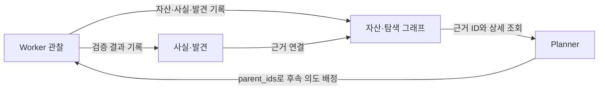

# 기능 추가

[변경점 전체 목록](../changes.md) · 비교 기준: 한국어판 ARTEX/global `fdfb7a1`

구독 계정 연결, 브라우저·이미지, 작업·자원 템플릿에 더해 Planner·Worker 사이의 근거 인계를 보완합니다. 기존 두 그래프를 연결하는 방식으로 확장합니다.

### 로그인·모델 연결

| 기능 | 원본 | 현재 동작 |
| --- | --- | --- |
| ChatGPT 개인 계정 | 공급자 API 키 중심 | 공식 **Sign in with ChatGPT**로 계정 연결·갱신·해제. Codex 설치 없이 구독 사용 |
| Daybreak 프로그램 설정·확인 | 별도 프로그램 선택·실제 적용값 표시 없음 | API 키·구독의 요청 방식을 구분하고, 완료 응답의 실제 모델·프로그램을 연결 확인과 저장된 카드에 표시 |

기존 **OpenAI API 키 연결과 API 모델 조회**는 유지합니다. ChatGPT 계정 연결은 ARTEX 관리자 로그인과 별도이며, 구독 사용 중 API 키 과금으로 자동 전환하지 않습니다. 프로그램별 실제 요청 방식은 [Daybreak 선택](openai.md#daybreak-선택)을 참고하세요.

작업·계획·Worker, Bash 등 로컬 도구, MCP, Skills와 일반 검색 연동도 유지합니다.

### 브라우저·이미지·프리셋

| 기능 | 원본 | 현재 동작 |
| --- | --- | --- |
| 사용자 인증 인계 | 브라우저 MCP는 있으나 ARTEX에서 같은 화면을 직접 조작하는 관리 흐름 없음 | 작업자별 브라우저를 분리하고 로그인·추가 인증 때 사용자에게 제어 전달. 같은 쿠키·저장소로 에이전트 재개 |
| 시각 입력 | MCP의 이미지 결과를 텍스트 위주로 처리 | 스크린샷과 `Read` 이미지가 실제 시각 입력으로 전달. 이미지 파일·해시를 보존해 대화 재개에도 사용 |
| 작업 프리셋 | 설명·목표·분류·작업별 허용/차단 규칙을 저장·적용하는 작업 템플릿 | 기존 템플릿에 실습·운영 관찰·일반·확장 기본값 4종 추가. 작업 이름과 시간 제한·계획 주기·초기 의도·커버리지 저장까지 확장 |
| 자원 프리셋 | Worker·동시 작업·도구 등을 각각 설정 | 상단 Low / Medium / High 버튼으로 병렬량과 기본 도구 조합 적용. 개별 설정은 같은 화면에 유지 |

작업 프리셋은 기존 생성 폼에 설정값을 채우는 템플릿입니다. 수행 지침은 편집 가능한 설명·목표에 들어가고, 최종 입력값이 기존 작업 생성·목표 분해·실행 경로로 전달됩니다. 4종 모두 범위별 검증·근거·미완료 질문·완료 조건을 담으며, 관찰·실습·일반·확장 검증의 허용 범위와 정리·복구 조건을 구분합니다. 미지정·null·0·false와 초 단위 설정을 구분해 보존하고, 최초 등록 후 사용자가 수정·삭제한 템플릿과 이미 만든 작업은 덮어쓰지 않습니다. 자산 범위 규칙은 기존 도메인·IP·URL 등의 허용/차단 기능을 따릅니다. 자원 프리셋은 현재 설치된 도구를 공통 목록에서 관리해 새 MCP·스킬도 같은 등급에 연결할 수 있도록 했습니다. 수치·적용 시점·인증 파일 관리 방법은 [브라우저·인증 세션과 실행 프리셋](../browser-and-presets.md)을 참고하세요.

관리 브라우저는 사용자 제어 반환과 세션 종료·작업 취소를 구분합니다. 화면 캡처는 현재 뷰포트를 읽으며, 페이지 이동으로 관측을 재시도할 때도 클릭·폼 제출 자체를 반복하지 않습니다. 프로필·인증 저장소는 세션별로 유지하고 종료 시 프로세스와 실행 슬롯을 정리합니다.

## 실제 브라우저 응답의 자산 연결

원본의 브라우저 도구에 **실제 응답 관찰 → endpoint 자산 → 관찰 사실 → 생산 의도** 연결을 추가했습니다. Worker가 사용하는 ARTEX 관리 브라우저에서 `document`·`xhr`·`fetch` 응답의 URL·메서드·상태를 수집합니다. 페이지의 문장을 근거로 응답이 있었다고 추정하거나 요청 헤더·본문을 관찰 사실에 복사하지 않습니다.

현재 작업과 직접 연결된 작업의 범위·기존 대상, 자산 허용/차단 규칙을 확인한 뒤 범위 내 endpoint를 등록합니다. 범위 밖 주소는 확인할 후보로 사실에 남기며 작업 범위를 자동 확장하지 않습니다. 자산·관찰 사실·앵커·작업 출처는 함께 저장하고, 같은 의도의 관찰은 사실 하나에 모아 중복 노드와 컨텍스트 증가를 줄입니다. 도구 결과에는 등록·미등록·실패 수, 관찰 사실 ID와 최대 20개 자산 ID를 전달합니다. Planner는 해당 사실을 조회하고 `add_intent.parent_ids`로 후속 의도에 연결할 수 있습니다.

자동 관찰 사실은 `observation_source=http_response`로 구분해 DB와 자산 연결에 보존합니다. Planner의 최근 일반 사실과 Worker 종료 안내에서는 이 관찰 ID를 제외해 반복된 응답 메타데이터가 Worker 결론을 밀어내지 않게 합니다. 필요한 관찰 원문은 `list_facts`와 `node_detail`에서 조회할 수 있습니다.

이 자동 등록은 Worker의 관리 브라우저 경로에 적용됩니다. Bash·curl 출력이나 임의의 외부 MCP까지 자동으로 해석하는 기능은 아니며, 그 경로의 관찰은 기존 `insert_assets`·`record_fact`로 연결합니다. HTTP 응답을 관찰했다는 사실은 취약점을 검증했다는 뜻이 아닙니다. [수집 한도·중단 동작](behavior.md#브라우저-관찰의-수집-한도)을 함께 참고하세요.

관련 구현: [`scripts/browser-session.cjs`](../../scripts/browser-session.cjs), [`server/browser_sessions.go`](../../server/browser_sessions.go), [`agent/worker.go`](../../agent/worker.go), [`db/http_observations.go`](../../db/http_observations.go).

## 근거 인계와 완료 근거

Worker는 관찰·부분 결과·다음 검증 질문을 `record_fact` 또는 실제 재현된 `report_finding`에 남깁니다. Planner는 사실·발견의 근거 ID를 `add_intent.parent_ids`에 연결해 새 의도를 배정하고, 미배정 질문과 선행 결과를 기다리는 단계를 Todo에 남깁니다. Todo의 `in_progress` 표기와 실제 실행 중 의도는 별도로 대조합니다. 필요한 선행 조건이 준비되지 않았다면 그 조건을 확보할 작업도 검토합니다. 이미 그래프에 있는 결과를 매 의도마다 대장에 다시 쓰지 않습니다.

기존 fact payload의 `follow_ups`는 조회·보관·복원에서 보존합니다. 현재 후속 계획은 fact/finding의 근거 연결과 Todo를 사용하며, 직접 연결된 다른 작업의 결과는 읽기 전용으로 조회합니다.

마지막 목표는 `open`·`running`·`paused` 의도가 남아 있으면 `completion_review`가 있어도 증명할 수 없습니다. 해당 의도를 마치거나 실제 중단 사유를 남겨 명시적으로 종료한 뒤 판단합니다. 중간 목표의 개별 증명은 계속할 수 있습니다. Planner Todo의 `pending`·`in_progress` 항목이 남는 경우에는 목표 달성과의 관계를 `completion_review`로 설명하고 당시 미처리 항목과 검토 내용을 함께 저장합니다. `pending_todo_indexes`는 당시 저장된 Todo 배열의 0부터 시작하는 위치입니다. 관련 구현: [`db/graph_mutations.go`](../../db/graph_mutations.go), [`db/task_completion.go`](../../db/task_completion.go).

실제 실행 종료 직전에는 저장된 검토와 현재 목표·의도·Todo·새 사실·발견을 다시 대조합니다. 새 목표가 생기면 완료를 거절하고, 검토 뒤 새 근거나 진행할 의도가 생기면 목표를 다시 열어 Planner가 검토합니다. 열린·실행 중·일시정지 의도를 매번 확인하고 Todo의 revision·내용 해시와 마지막 분석 결과 경계를 비교하므로 같은 의도의 재개나 같은 위치의 할 일 변경도 다시 검토합니다. 목표가 없는 구형 작업에도 미완료 계획이 남으면 검토를 이어가며, 계획이 없는 수동 작업의 실행 경로는 유지합니다. 시간 제한에 도달했을 때도 같은 검사를 적용하며, 남은 작업은 달성으로 표시하지 않고 시간 초과로 구분합니다. `goal_met`을 따로 연결한 경우에도 아직 열린 목표의 개별 증명을 건너뛸 수 없습니다. [`db/task_completion.go`](../../db/task_completion.go), [`server/task_completion.go`](../../server/task_completion.go)

## 실행 설정과 기록 비교

작업 개요에 현재 역할별 모델·추론 강도·요청 프로그램, 작업 생성 시 저장한 Worker 수, 현재 브라우저 상한·직접 접근 설정·캡처 상태를 표시합니다. 실행 기록에는 시스템 지침과 도구 정의의 해시, 요청 설정과 응답 메타데이터를 남겨 서로 다른 실험의 설정을 비교할 수 있습니다. [화면의 의미](behavior.md#작업-상태와-그래프-표시), [실행별 요청·응답 기록](openai.md#실행별-요청응답-기록)을 참고하세요.

진행 중 Worker 상태는 작업 API와 화면에서 볼 수 있습니다. Planner의 `graph_overview`에 이 상태 배열을 매 라운드 넣지 않아 모델의 상시 입력은 늘리지 않습니다. 진행 상태는 메모리 값이므로 서버 재시작 후 이전 값을 복원하지 않습니다.
