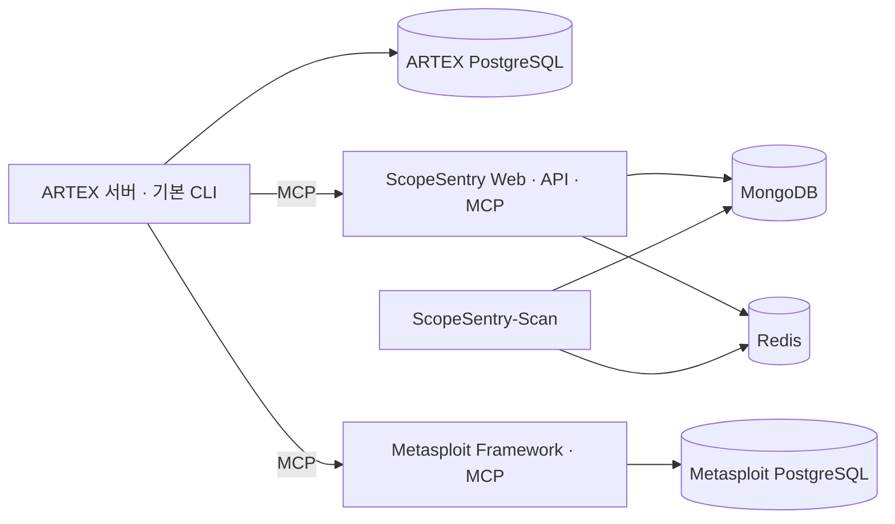

# 침투 테스트 도구와 스킬

Docker 이미지의 CLI와 기존 사용자 도구·MCP·스킬 등록 기능을 연결합니다. 독립 **침투 테스트** 에이전트(`pentest`)와 작업의 **실행** 에이전트(`worker`)가 기본 대상입니다. Goals·Planner의 작업 배정과 기존 결과 기록 흐름은 유지합니다.

## 기본 제공 구성

| 구성 | 실행·사용 경로 | 연결 스킬 |
| --- | --- | --- |
| Nmap | `Bash` → `nmap` | `web-cli` |
| ffuf | `Bash` → `ffuf` | `web-cli` |
| sqlmap | `Bash` → `sqlmap` | `web-cli` |
| SecLists 선택 목록 | `/usr/share/seclists`의 파일을 CLI에 전달 | `web-cli` |
| NetExec | `Bash` → `nxc` 또는 `netexec` | `ad-tools` |
| Impacket | `Bash` → `impacket-GetADUsers` 등 `impacket-<스크립트명>` | `ad-tools` |
| Certipy | `Bash` → `certipy` | `ad-tools` |
| Python·Node.js·PHP·JDK·Maven | `python3`, `node`, `npm`, `php`, `java`, `javac`, `mvn` | `poc-research` |
| ScopeSentry MCP | 별도 서비스의 자산·결과 조회와 스캔 도구 | `scopesentry` |
| Metasploit MCP | 별도 서비스의 모듈·작업·세션 도구 | `metasploit` |

CLI 항목은 기존 사용자 도구의 `shell` 유형입니다. 에이전트의 Bash 설명에 설치 환경을 알리고 Bash가 명령을 실행합니다. 이 항목을 끄면 환경 안내에서 빠지며, 설치된 명령 자체의 실행을 차단하는 설정은 아닙니다. 도구별 실행 어댑터나 임의 옵션을 한 문자열로 받는 `command` 래퍼를 추가하지 않습니다.

첫 등록 때 실행 파일과 사전 파일의 존재를 확인합니다. 준비된 항목은 활성화하고, 없는 항목은 비활성으로 등록합니다. 이후 사용자가 수정·비활성화·삭제한 도구와 스킬 연결은 재시작으로 복원하지 않습니다. Docker 외 환경에서 등록한 뒤 CLI를 설치했다면 사용자 도구 화면에서 해당 항목을 켜면 됩니다. 실행 파일 존재 확인은 버전·외부 접속·계정 설정의 검증과 다릅니다.

스킬 목록의 짧은 설명으로 사용할 절차를 알리고, 모델이 `Skill`을 호출하면 본문을 읽습니다. 이번에 기본으로 제공하는 5개 스킬은 첫 적용 때 연결하며, 이후 에이전트 설정에서 해제한 연결은 보존합니다. 기존 `api-recon` 연결, 같은 이름의 사용자 도구와 기존 MCP 설정은 덮어쓰지 않습니다.

## 이미지의 설치 범위

- ffuf 2.3.0, sqlmap 1.10.10, Impacket 0.13.1, Certipy 5.1.0을 설치합니다. NetExec은 공식 소스의 `30cf146578a597d86b2701c633790665474a902b`를 사용합니다.
- Python 도구는 `/opt/artex-tools/{sqlmap,netexec,impacket,certipy}`의 별도 가상 환경을 사용합니다. Impacket의 원본 `.py` 스크립트는 해당 환경의 `bin/`에 있습니다.
- SecLists는 고정 소스 `145f1f45ba7bc5fd6b3966d3a79bf95654deb20e`에서 웹 경로·인자·API·DNS 목록 5개와 라이선스만 포함합니다. 목록은 `skills/web-cli/SKILL.md`에 안내합니다.
- 기존 Python 3.12·Node.js 24에 Debian bookworm의 PHP 8.2, JDK 17, Maven을 추가합니다. 특정 PoC가 요구하는 버전·확장·라이브러리는 별도로 맞춰야 합니다.

주요 도구 버전·소스를 고정하더라도 NetExec의 Git 전이 의존성과 Debian 패키지 전체를 잠그는 구성은 아닙니다. 실제 설치 버전은 이미지에서 확인합니다. 실행 결과 비교에는 이미지 식별자와 도구·런타임 버전을 함께 남깁니다.

ScopeSentry에서 사용하는 httpx·Katana·Nuclei의 별도 설치, GitHub MCP, BloodHound CE와 별도 지식 검색 서버는 기본 구성에 포함하지 않습니다. 자료 조회에는 기존 `WebFetch`와 공식 보안 공지·패치를 사용합니다. `WebSearch`는 기존 전역·에이전트 검색 설정이 활성화된 경우 사용할 수 있으며, 이번 등록이 검색 설정을 바꾸지는 않습니다.

## MCP 설정

`pentest`와 `worker`에는 `web-cli`, `ad-tools`, `poc-research`, `scopesentry`, `metasploit` 스킬을 기본 연결합니다. 기존 `api-recon` 연결도 유지합니다. Goals·Planner 등 다른 에이전트의 연결은 바꾸지 않습니다.

통합 배포는 주소·인증이 준비된 `ScopeSentry`와 `Metasploit` MCP를 처음 한 번 활성화합니다. 기본 Compose만 사용하거나 인증값이 없으면 두 MCP는 빈 주소의 비활성 항목으로 남습니다. 기존 사용자가 설정·비활성화·삭제한 MCP와 해제한 스킬 연결은 덮어쓰지 않습니다.

별도로 운영하는 서비스를 연결할 때는 기존 설정 화면을 사용합니다.

1. 별도 서비스를 준비합니다.
2. ARTEX MCP 설정에서 아래 이름과 주소·헤더를 맞추고 활성화합니다.
3. 도구 목록을 새로 조회해 연결과 실제 제공 기능을 확인합니다. 에이전트의 다음 실행에서 적용됩니다.

| 등록 이름 | 전송 | 주소 | 인증 헤더 |
| --- | --- | --- | --- |
| `ScopeSentry` | `http` | 통합 구성은 `http://scopesentry:8082/mcp` | `X-API-Key` |
| `Metasploit` | `http` | 아래 Compose 사용 시 `http://metasploit:3000/` | `Authorization: Bearer <설정한 토큰>` |

서버 이름은 스킬의 `mcps:` 값과 대소문자까지 같아야 합니다. 활성화된 서버에는 에이전트 도구를 구성할 때 연결해 `tools/list`를 조회합니다. 해당 스킬을 읽으면 도구 이름이 공개되고 `SearchExtraTools` → `ExecuteExtraTool`로 스키마를 확인해 호출합니다. 스킬 본문을 읽기 전까지 연결 비용도 지연되는 구조는 아닙니다.

스킬이 MCP를 연결하므로 에이전트의 직접 MCP 연결을 중복 선택할 필요는 없습니다. 사용을 해제하려면 해당 스킬 연결을 해제하거나 MCP 자체를 비활성화합니다. 직접 MCP 연결을 따로 추가했다면 그 연결도 해제해야 합니다.

ScopeSentry의 스캔 결과는 기존 조회·동기화 기능과 현재 작업의 기록 도구로 활용합니다. 스킬 연결 자체가 결과를 ARTEX 그래프에 자동 등록하지는 않습니다.

## 통합 Docker 배포

기존 ARTEX 서버·PostgreSQL에 [Metasploit 구성](../docker-compose.metasploit.yml)과 [통합 구성](../docker-compose.pentest.yml)을 추가합니다. ARTEX는 하나의 앱 서버로 유지하며 ScopeSentry 서버·Scanner·MongoDB·Redis, Metasploit·전용 PostgreSQL을 별도 컨테이너로 실행합니다. ScopeSentry와 Metasploit은 각 서버의 내장 MCP를 사용합니다.



Docker Compose와 호스트 Python 3가 필요합니다. 저장소 루트에서 다음 순서로 실행합니다. 준비 스크립트는 컨테이너나 스캔 작업을 직접 시작하지 않습니다.

```bash
python3 scripts/prepare-pentest.py init

docker compose --env-file .env.pentest \
  -f docker-compose.yml -f docker-compose.metasploit.yml -f docker-compose.pentest.yml \
  up -d --wait scopesentry metasploit

python3 scripts/prepare-pentest.py connect

docker compose --env-file .env.pentest \
  -f docker-compose.yml -f docker-compose.metasploit.yml -f docker-compose.pentest.yml \
  up -d --build
```

`init`은 임의 인증값을 `.env.pentest`에 생성하고 ScopeSentry 설정 파일을 `.local/pentest/`에 준비합니다. 파일은 비공개 권한으로 만들며 기존 환경 파일·설정은 덮어쓰지 않습니다. `connect`는 ScopeSentry 공식 로그인·API 키 발급 API를 사용해 MCP 인증을 확인하고 같은 환경 파일에 키를 저장합니다. 재실행 시 기존 키를 재사용하며 인증 실패를 새 키 발급으로 숨기지 않습니다.

| 항목 | 준비 스크립트 기본값 |
| --- | --- |
| Compose 프로젝트 | `artex-pentest` — 기존 릴리스 비교 환경과 별도 |
| ARTEX 화면 | `http://127.0.0.1:8788`, 계정 `ARTEX` |
| ARTEX 초기 비밀번호 | `.env.pentest`의 `ARTEX_ADMIN_PASSWORD` |
| ScopeSentry 화면 | `http://127.0.0.1:18083`, 계정 `ScopeSentry` |
| ScopeSentry 초기 비밀번호 | `.local/pentest/server-password` |
| Scanner 노드 이름 | `artex-pentest-node` |
| ScopeSentry / Scanner | 공식 이미지 `1.9.4` / `1.9.1`, 이미지 digest 고정 |
| MCP·DB 포트 | Compose 내부 네트워크 사용. DB와 Metasploit MCP는 호스트 미공개 |
| Metasploit 실행 권한 | `MSF_MCP_DANGEROUS_ACTIONS=false` — 모듈·작업·세션 조회 사용 가능 |

두 MCP는 새 ARTEX DB 또는 사용자가 한 번도 편집하지 않은 빈 기본 항목에만 환경값을 적용합니다. 이미 구성한 DB에서 주소·키를 바꾸려면 MCP 설정 화면에서 갱신하세요. 환경 파일의 인증값을 바꾸고 재시작하는 것만으로 저장된 MCP 설정을 덮어쓰지 않습니다.

초기 입력 계약은 `ARTEX_SCOPESENTRY_MCP_URL` + `ARTEX_SCOPESENTRY_API_KEY`, `ARTEX_METASPLOIT_MCP_URL` + `ARTEX_METASPLOIT_MCP_TOKEN`입니다. 통합 Compose가 서비스 내부 주소와 발급한 인증값을 전달합니다. Metasploit 토큰에는 `Bearer `를 붙이지 않으며 저장할 때 접두사를 붙입니다.

`connect` 후 전체 구성을 기동하면 ARTEX MCP 화면에서 활성 상태와 발견한 도구를 확인할 수 있습니다. ScopeSentry 노드가 온라인인지도 확인하세요. MCP 연결·도구 목록 조회 성공은 Scanner의 모든 플러그인 검사 통과와 다릅니다. Scanner는 시작할 때 플러그인 설치와 자체 검사를 수행하며 일부 검사에서 외부 DNS·네트워크를 사용합니다. 원본의 ksubdomain 시작 검사는 최대 5분을 기다릴 수 있어 노드 등록이 늦어질 수 있습니다. raw packet 기반 기능은 Docker 호스트·네트워크 환경에 따라 별도 검증이 필요합니다.

업데이트·중지에도 같은 `--env-file`과 세 Compose 파일을 사용합니다. 프로젝트별 DB·Scanner·도구 볼륨, `.env.pentest`, `.local/pentest/`를 함께 보존하세요. `down -v`는 해당 프로젝트의 DB와 결과를 삭제합니다. ScopeSentry 설정·API 키가 바뀌지 않도록 비공개 파일도 백업 대상에 포함합니다. 이 구성은 공식 amd64 이미지를 사용하며 ARM에서는 에뮬레이션 검증이 별도로 필요합니다.

DB 비밀번호와 Scanner 노드명은 첫 초기화 이후 환경 파일만 바꿔도 기존 저장 설정이 자동 변경되는 값이 아닙니다. 변경할 때는 DB 계정과 Scanner 설정 볼륨의 `config.yaml` 등 관련 저장 설정도 함께 갱신해야 합니다.

## 선택 설치: Metasploit

[추가 Compose 설정](../docker-compose.metasploit.yml)은 공식 Metasploit 이미지와 전용 PostgreSQL·볼륨을 사용합니다. 기본 ARTEX Compose에 추가해서 실행합니다.

고정 이미지의 MCP SDK는 기본적으로 loopback Host만 허용하므로, [Docker 실행 파일](../docker/metasploit/mcp-server.rb)이 내부 주소 `metasploit:3000`을 허용 목록에 추가한 뒤 원본 `msfmcpd`를 실행합니다. 기존 Host·Origin 검증과 Bearer 인증은 유지합니다.

```bash
export MSF_MCP_AUTH_TOKEN='<직접 정한 비공개 토큰>'
docker compose -f docker-compose.yml -f docker-compose.metasploit.yml up -d metasploit
```

ARTEX와 같은 Compose 프로젝트 이름을 사용해야 내부 주소 `http://metasploit:3000/`로 연결됩니다. 호스트에는 MCP 포트를 공개하지 않으므로 기존 3000번 포트와 충돌하지 않습니다. 호스트에서 ARTEX 바이너리를 직접 실행한다면 별도 접근 가능한 주소가 필요합니다.

인증 토큰은 ARTEX의 `Authorization` 헤더에도 `Bearer ` 접두사를 붙여 입력합니다. 선택적으로 `MSF_POSTGRES_PASSWORD`를 지정할 수 있습니다. 토큰·비밀번호를 저장소에 커밋하지 않습니다.

공식 서버 기본값에서는 모듈 검색·정보 및 작업·세션·DB 조회를 사용할 수 있습니다. 실행 도구도 목록에 나타나지만 호출 시 차단됩니다. 모듈 검사·실행과 세션 입력·종료까지 사용하려면 같은 설정에서 다음 값을 지정한 뒤 서비스를 갱신합니다.

```bash
export MSF_MCP_DANGEROUS_ACTIONS=true
docker compose -f docker-compose.yml -f docker-compose.metasploit.yml up -d metasploit
```

현재 고정 공식 이미지는 `linux/amd64`입니다. ARM 호스트에서 이 선택 구성은 amd64 에뮬레이션이 필요합니다. ARTEX CLI 이미지의 대상 아키텍처와 구분합니다. [공식 MCP 사용법](https://github.com/rapid7/metasploit-framework/blob/master/docs/metasploit-framework.wiki/How-to-use-Metasploit-MCP-Server.md)

Metasploit 작업과 세션은 별도 서비스에 남습니다. ARTEX의 취소·대화 종료가 원격 작업을 자동 취소하거나 세션을 정리하지 않습니다. 스킬은 작업 UUID·세션 ID와 현재 상태를 다시 확인하도록 안내합니다. 콜백을 받는 모듈은 대상에서 도달 가능한 주소·포트 설정도 별도로 필요합니다.

## 동작과 비용

CLI 프로세스는 모델이 실행할 때 시작합니다. 설치만으로 상시 스캐너를 구동하지 않습니다. 도구 설명과 연결된 스킬 목록은 초기 컨텍스트를 늘리고, 활성 MCP는 연결·목록 조회 비용을 추가합니다. 도구와 스킬·MCP의 활성 상태는 각각 설정합니다. 모든 연결을 끄더라도 이미지 용량 증가는 남습니다.

검사는 실제 CLI 도움말·런타임 실행, 초기 등록과 사용자 설정 보존, 스킬 로딩과 MCP 호출 연결을 대상으로 합니다. GOAD·Dracarys 전체 풀이, 최신 PHP·Node.js·Java 취약점 재현이나 모델의 진단 성능 향상을 보장하지 않습니다.
